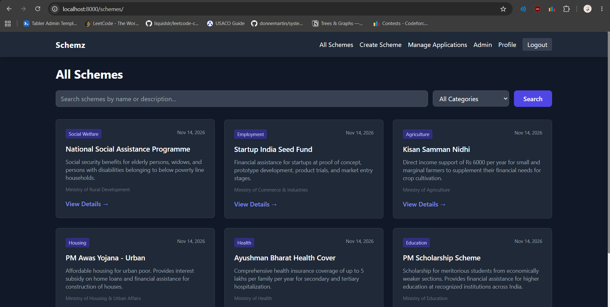
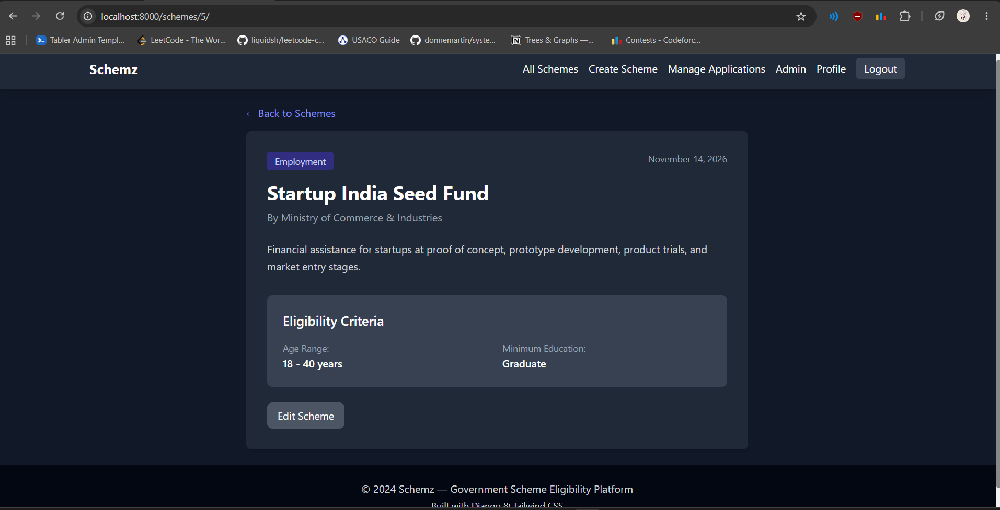
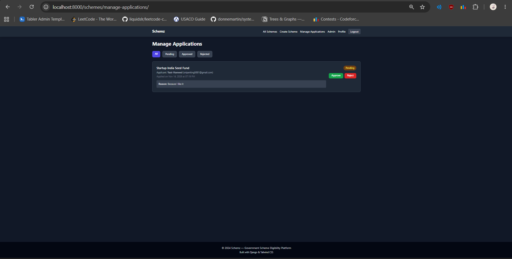

# Schemz

A Django web application that helps citizens discover and apply for government schemes based on their profile eligibility.

**SIH Problem Statement:** SIH26092 — AI-Driven Scheme Matching for Marginalized Entrepreneurs  
**Organization:** Ministry of Social Justice and Empowerment (MoSJE)

---

## Screenshots

| Home Page | Scheme Detail | Manage Applications |
|-----------|---------------|---------------------|
|  |  |  |

---

## Tech Stack

- **Backend:** Django 5+
- **Frontend:** Tailwind CSS (CDN)
- **Database:** SQLite

## Setup

```bash
# Install dependencies
pip install -r requirements.txt

# Run migrations
python manage.py makemigrations
python manage.py migrate

# Create superuser
python manage.py createsuperuser

# Start the server
python manage.py runserver
```

Open `http://127.0.0.1:8000` in your browser.

## Default Users

| Username | Password | Role |
|----------|----------|------|
| admin | admin123 | Superuser |
| organizer | org123 | Staff / Organizer |
| citizen | citizen123 | Regular User |

## Project Structure

```
schemz_django/
├── schemz/          # Project settings & root URLs
├── accounts/        # Registration, login, logout, profile
├── schemes/         # Schemes, applications, matching
├── templates/       # HTML templates (base + app-specific)
├── static/css/      # Custom CSS
├── manage.py
└── requirements.txt
```
